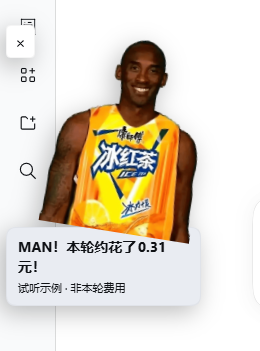
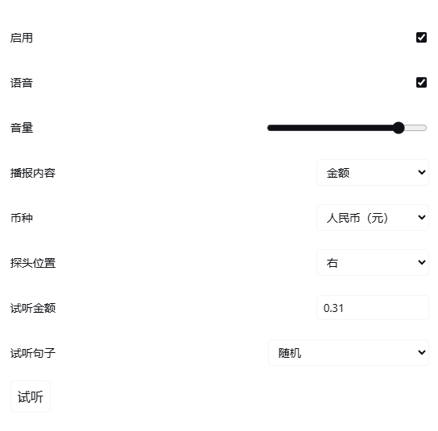

# Man！花了这么多钱！

一轮做完，科比冰红茶从屏幕边上探头，报出这轮的费用或 Token 用量。

- **随机台词**：金额模式二十句、Token 模式四句；自动提醒随机选一句，试听时也能逐句挑选。
- **金额 / Token**：金额支持人民币、美元与三位小数四舍五入；Token 模式只报整数用量，不报钱。
- **纯离线语音**：台词与数字全部内置，不需要语音服务账户或 API Key。
- **插件内设置**：在左侧插件详情页调整音量、探头位置、试听金额和句子。

**声音已经随插件预置。常用台词、数字和单位在本地拼接，不需要 API Key，播放时不调用豆包或其他语音服务。**

## 开始使用

在 DSH 的插件页安装此插件，按提示重启 DSH 并刷新页面。打开左侧 **插件 → Man！花了这么多钱！**，在插件详情页调整提醒设置或点击 **试听**。

安装时使用 npm 包名 **`dsh-man-031`**。发行版本见 [npm](https://www.npmjs.com/package/dsh-man-031) 和 [GitHub Releases](https://github.com/gongfpp/dsh-man-031/releases)。市场目录的审核与同步可能晚于发行包上线。

[dsh-cost-meter](https://www.npmjs.com/package/dsh-cost-meter) 为可选：装了优先使用它的本轮计费结果；没装或查询失败时，按各次请求的模型、原生 Token 用量与公开单价分别计算后求和，标注 **“按公开价格估算 · 非实际扣款”**。Token 模式不查询价格。

## 按你的习惯设置

- **播报内容**：选“金额”或“Token 用量”。Token 模式的字幕、试听和语音一起切换，不再出现钱或货币单位；有四套专用离线句式。
- **币种**：金额模式默认人民币，也可选美元。金额会一起换算，不只是换个单位。
- **位置**：从左边或右边探头。
- **音量**：调低一点，或关掉语音，只看图片提醒。
- **启用**：关闭后不再自动提醒，仍可手动预览。
- **试听金额 / 试听 Token 数**：按当前模式填写示例；Token 只接受非负整数。不改变真实记录。支持 0 至小于 1 万亿，无效或无法准确表示的输入不会播放。
- **试听句子**：金额模式二十句、Token 模式四句，均可指定或选“随机”。自动提醒每轮随机选一句，重试不会换句。

金额统一**保留三位小数、四舍五入**，字幕和语音使用同一个结果。例如 `0.000749 → 0.001`、`0.3105 → 0.311`、`9.9995 → 10.000`；语音省略无意义的末尾零。

二十句台词的开头、数字、单位和结尾均已随插件预置，在本地组合播放。人民币单位读中文“元”，美元读 dollar/dollars。试听只是示例，不是当前轮次的费用；不会为了试听调用在线语音服务。

## 报的是哪笔钱？

只报**当前主会话这一轮**，不是对话累计金额，也不混入无法准确归属的子任务费用。

- 优先采用 `dsh-cost-meter` 的本轮完整结果；确认套餐没有额外扣费时仍报零，不把套餐等价金额当作扣款。
- 缺少该插件、查询失败或结果不完整时，逐次请求按模型、输入、输出、缓存读取及写入的公开单价计算，再汇总；推理 Token 已包含在输出中，不重复收费。估算不代表账户实际扣款或套餐权益。
- 随包附带 [公开价格快照](assets/provider-pricing.json)，首次需要回退时后台检查更新，每个宿主实例最多每天一次；网络失败继续用本地快照。价格表来自 [dsh-cost-meter](https://github.com/Han-1413141/dsh-cost-meter)，美元换人民币使用带日期的公开汇率；定价与汇率可能滞后，以账单为准。许可见 [价格数据许可](docs/PRICING-LICENSE.txt)。
- 缺少任一请求的用量或有效价格时显示“费用暂不可用”，不把未知当作零；临时接口请求失败可重试。

**Token 模式**只累计本轮原生输入＋输出＋缓存读取＋缓存写入，推理用量不再加一次；不依赖费用插件或价格表。字幕示例为“MAN！本轮用了 1,234 个 Token！”，语音使用同一整数与 token/tokens 单位。缺失用量时不会冒报零。

## 没有声音？

先点击 **试听**，检查系统音量和浏览器是否静音。音频加载或播放失败时，可点提醒里的 **重试**。页面应保持前台；切走后不会补播一串历史提醒。

## 说明

这是娱乐提醒，不是支付通知，也不代表科比或相关品牌背书。声音由豆包预先合成，参考用户选定的 AI 声音成品，不是科比本人新录音。素材来源见[素材说明](docs/SOURCES.md)。源代码与随包素材不因公开下载而自动获得开源或再分发许可。
